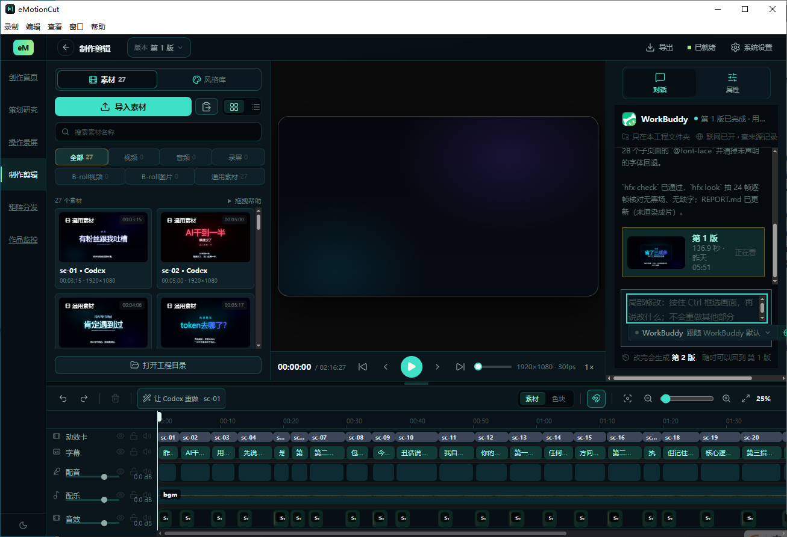
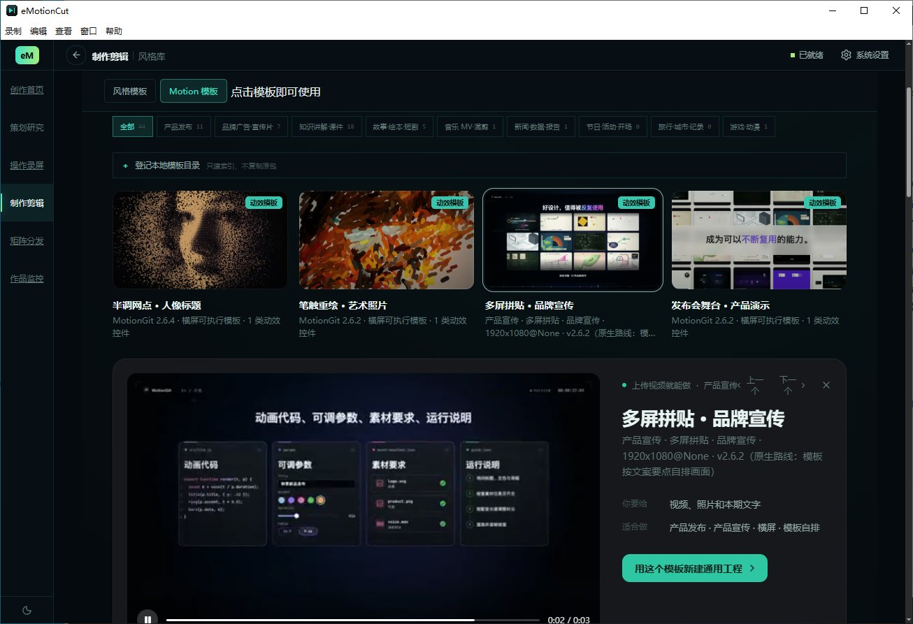
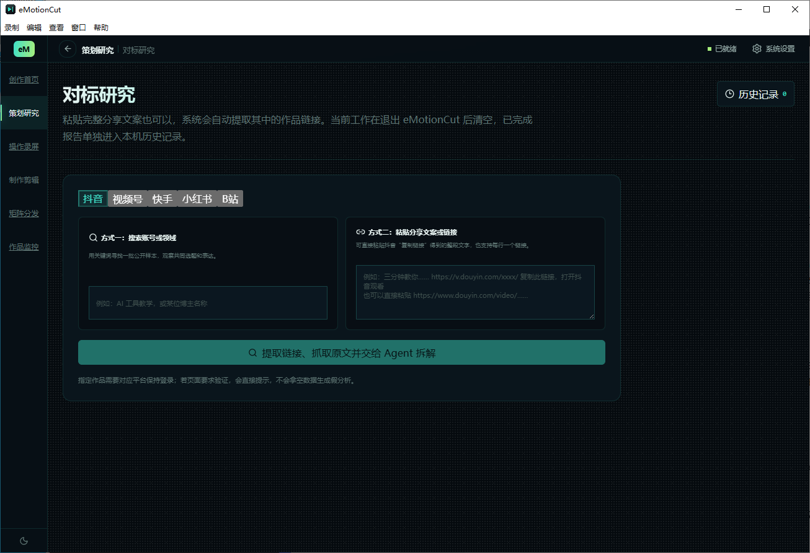
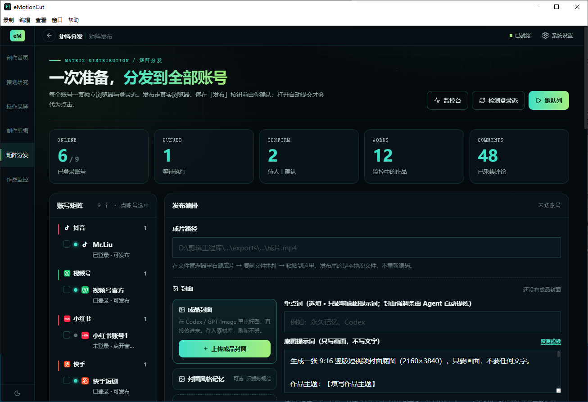
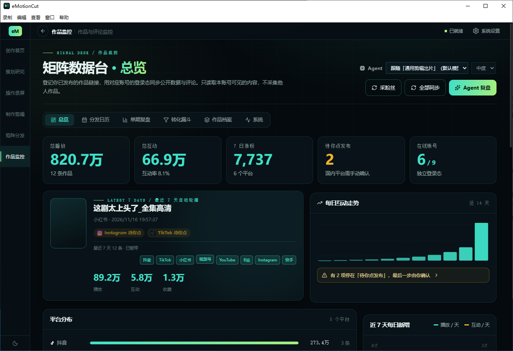
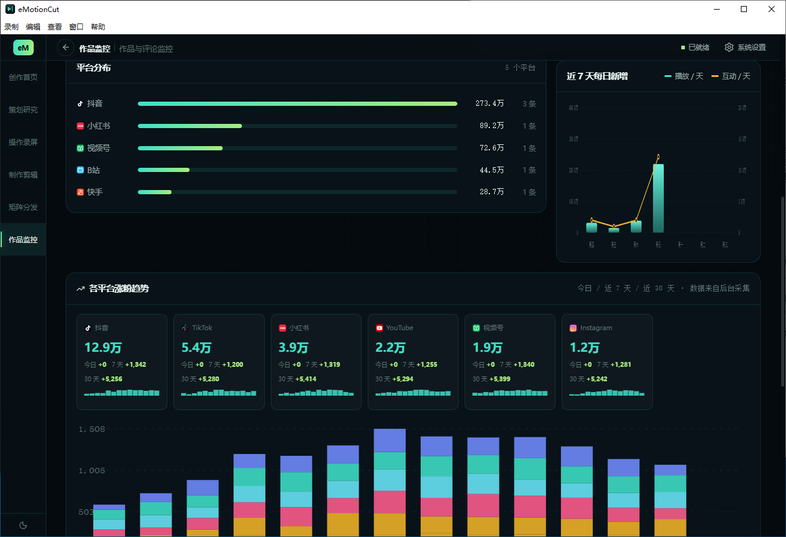
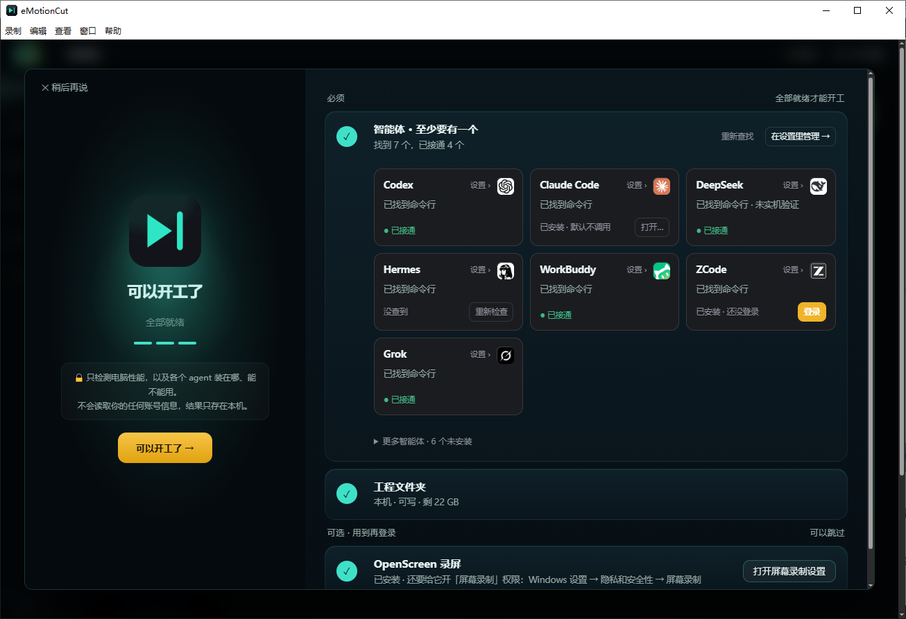

<div align="center">

# eMotionCut

### An AI content studio that directs, edits, and distributes like a matrix

eMotionCut is a local-first desktop workspace that runs the whole short-video pipeline — benchmark research, scriptwriting, agent-directed editing, multi-account distribution, and comment-driven analytics — on one machine.

[简体中文](README.zh-CN.md) · [Releases](https://github.com/markmushian/eMotionCut/releases) · [Issues](https://github.com/markmushian/eMotionCut/issues)

    



</div>


## What eMotionCut is

- **Agent-directed editing** — pick a style, drop in raw footage, and an agent directs the cut on a real timeline. Motion templates are executable: watch the demo, check parameters and required assets, apply in one click.
- **One five-step pipeline** — competitive research → scriptwriting → agent editing → matrix distribution → analytics, laid out as a single production line the moment you open the app.
- **Matrix distribution** — publish one finished video to every account in your matrix through each account's real browser login. Batch-submit automatically, or keep every post waiting for your manual confirm.
- **Three cover paths** — upload a finished cover, generate with the local Codex CLI, or one-click generate with Doubao Seedream (native 9:16 master plus 3:4 / 4:3 variants). Every cover lands in one reusable library and rides along with its publishing task.
- **Signal desk analytics** — total plays, engagement, 7-day follower growth, per-platform trends, and agent review reports written from real comments. Data is collected from your own accounts only.
- **Local-first by design** — accounts, login sessions, logs, and API keys stay on this machine. Publishing runs a real browser you can watch, interrupt, and confirm.
- **Chinese-first experience** — Simplified Chinese is the primary interface language, with a day/night theme switch.

## How the pipeline works

```
You
 └─ One brief — a topic, or a pile of raw footage
     ├─ 01 Competitive research → benchmark accounts, works, audience
     ├─ 02 Scriptwriting        → agent writes the voiceover from your notes
     ├─ 03 Agent directing      → style + Motion templates → finished cut
     ├─ 04 Matrix distribution  → one video, every account, covers attached
     └─ 05 Signal desk          → plays, comments, follower growth, review
              ↓
        You stay the final reviewer — nothing posts without you.
```

## Platforms

Douyin · Channels (视频号) · Xiaohongshu · Kuaishou · Bilibili · Toutiao · YouTube · TikTok · Instagram

Accounts sign in through the built-in browser on this machine; publishing and per-platform analytics depend on what each platform allows in that session.

## Quick start

### Download prebuilt (recommended)

1. Grab the latest `eMotionCut-v*.zip` from [Releases](https://github.com/markmushian/eMotionCut/releases/latest).
2. Unzip it anywhere and double-click `eMotionCut.exe` — portable, no installer, no Node.js required.

### Build from source

#### Requirements

- Node **24.x** (`>=24.15.0 <25`)
- Windows 10 2004+ x64

#### Install & run

```bash
npm ci
npm start          # or double-click 启动开发版.cmd
```

The dev launcher cleans two common startup blockers first: duplicate `HTTP_PROXY` keys with different letter cases, and a leftover `ELECTRON_RUN_AS_NODE=1`. Launch logs go to `.dev/launch.log`.

On first launch the app detects AI CLIs already installed on this machine (Codex, Claude Code, WorkBuddy, Grok, ZCode …), connects the signed-in ones, and stores results locally.

### Production preview & packaging

```bash
node --experimental-strip-types desktop/service.mjs production 3188
# open http://127.0.0.1:3188/
```

```bash
npm run build            # frontend + native components (MSVC required)
npm run build:installer  # Windows installer
npm run typecheck        # type check
npm test                 # tests
npm run doctor           # environment check
```

### Cloud services

Under **系统设置 → 账号与服务接入** configure agent CLI logins and cloud generation (Doubao Ark for images, MiniMax for voice, Hailuo for video). Keys are stored in this machine's keychain only.

## Core areas

### Agent directing & Motion templates

- Style library plus an executable Motion template wall: open any template to see the demo, use cases, parameters, and required assets before applying it.
- Full timeline editor: footage/style dual rail, an agent chat panel that reshapes the cut, per-version rollback.



### Competitive research

- Keyword search or paste a share link; the agent extracts works and breaks them down.
- Crawling reuses each matrix account's built-in browser login state — no system Chrome dependency.



### Matrix distribution & covers

- Publishing orchestration: drag or paste the finished cut, attach a cover, add focus words and a cover prompt. Cover image prompts only drive the artwork; title styling is distilled by the agent automatically.
- Covers ride with the publishing task. When a platform's upload selector misses, the app asks you to pick the file manually once instead of faking success.



### Signal desk analytics

- Overview cards for total plays / engagement / 7-day follower growth / pending confirms / online accounts, plus a per-work card for the latest 7 days.
- Daily engagement trend, platform ranking bars, and per-platform follower growth with today / 7-day / 30-day deltas — collected by the background monitor, not by hand.
- Agent review reads the actual comments: run it across the whole matrix or drill into one single work. Sync logs, cohort comparison, funnel, and work archive live on the same page.





### One-click deployment

- First launch scans this machine for agents (Codex / Claude Code / DeepSeek / WorkBuddy / Grok / ZCode …); signed-in ones connect automatically. Results never leave the machine.



## Build from source

```bash
git clone https://github.com/markmushian/eMotionCut.git
cd eMotionCut
npm ci
npm start
```

Quality gates before pushing:

```bash
npm run typecheck
npm test
```

## Project layout

| Path | Content |
| --- | --- |
| `src/` | Frontend (React 19 + Vite) |
| `server/` | Local services, editing engine, export, matrix distribution |
| `desktop/` | Electron main process, installer, recording control |
| `vendor/openscreen` | Upstream OpenScreen (screen recording) |
| `public/` | Static assets and brand material |
| `scripts/` | Build and release scripts |
| `docs/screenshots/` | README screenshots |

## Project identity and attribution

eMotionCut is an independent desktop product built from AGPL-3.0-only source and substantially modified in branding, Chinese UX, desktop startup, matrix distribution, cover generation, and the signal desk. eMotionCut remains the upstream project name; its name and "T" mark are not used here — see [NOTICE](NOTICE) and [TRADEMARK.md](TRADEMARK.md).

License: [AGPL-3.0-only](LICENSE). Third-party notices: [NOTICE](NOTICE) and [THIRD-PARTY-LICENSES.json](THIRD-PARTY-LICENSES.json).
