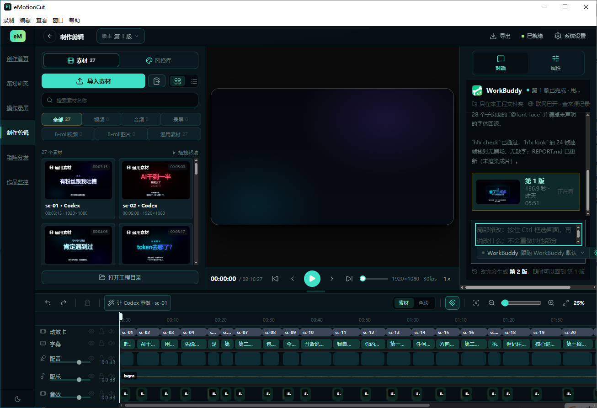
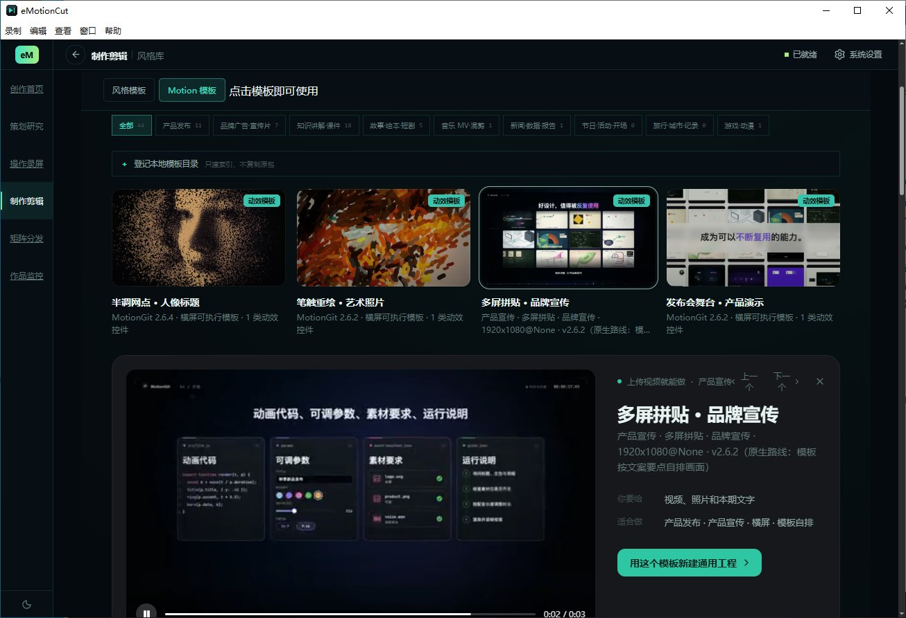
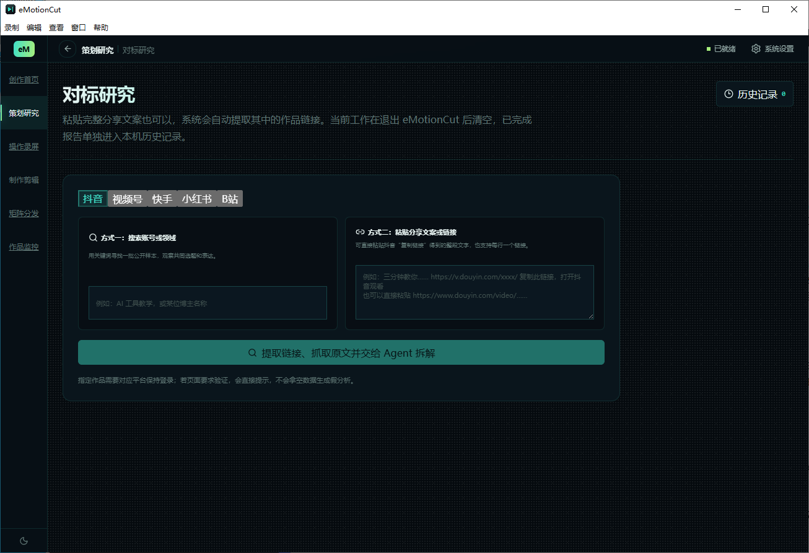
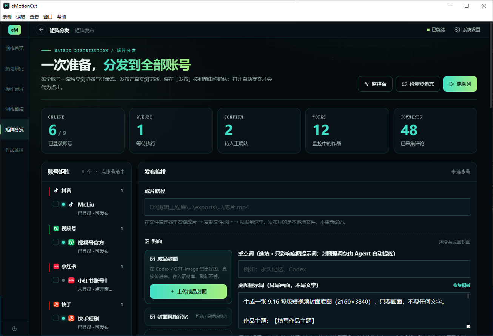
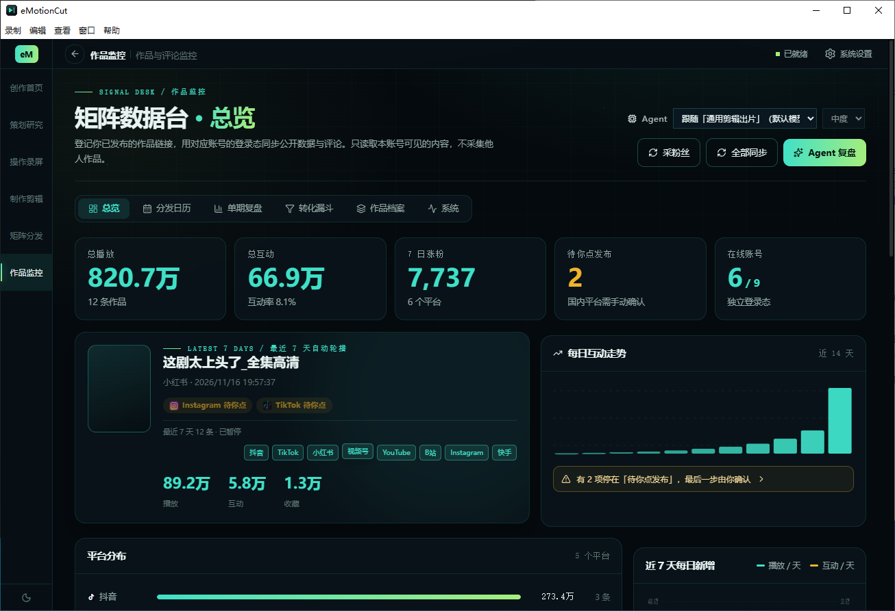
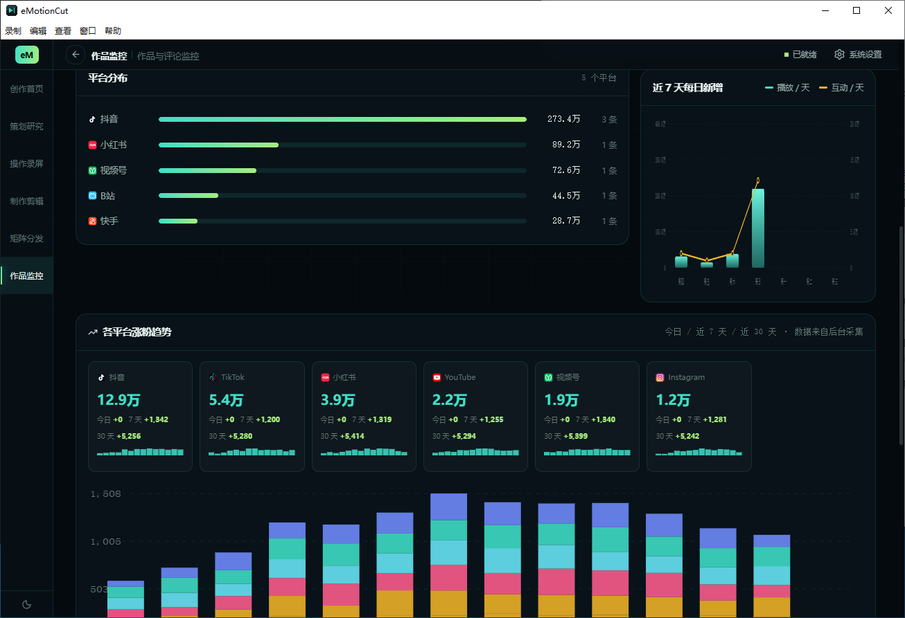
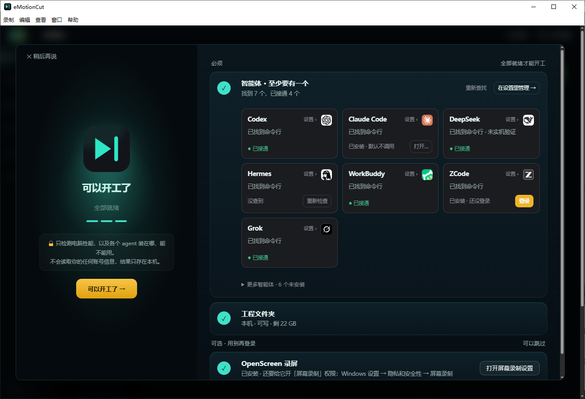

<div align="center">

# eMotionCut

### 一个像矩阵号一样「导演、剪辑、分发」的 AI 内容工作室

eMotionCut 是一个本地优先的桌面工作台，把短视频全流程——对标研究、写稿、Agent 导演剪辑、多账号矩阵分发、评论驱动的数据复盘——装进一台电脑。

[English](README.md) · [Releases](https://github.com/markmushian/eMotionCut/releases) · [Issues](https://github.com/markmushian/eMotionCut/issues)

    



</div>


## eMotionCut 是什么

- **Agent 导演剪辑** — 挑风格、放素材，Agent 在真实时间线上导演出片；Motion 模板可执行：先看演示动画、参数与素材要求，选中即用。
- **五步流水线** — 对标研究 → 写稿 → Agent 剪辑 → 矩阵分发 → 数据复盘，打开应用就是一条生产线。
- **矩阵分发** — 一条成片分发到矩阵里的每个账号，发布走各账号真实浏览器登录态；可以开自动提交批量跑，也可以逐条人工确认。
- **封面三条路** — 上传成品封面、本机 Codex 出图、豆包 Seedream 一键生图（原生 9:16 母版 + 3:4 / 4:3 变体）；出完都进同一个成品封面库，随发布任务一起带上。
- **数据台复盘** — 总播放 / 总互动 / 7 日涨粉 / 每日走势 / 平台排行 / 各平台涨粉趋势，Agent 读真实评论写复盘报告；只采集本账号数据。
- **本地优先** — 账号、登录态、日志、密钥都留在这台电脑；发布过程是看得见、可打断、需确认的真实浏览器。
- **中文优先** — 简体中文是主界面语言，自带日间 / 夜间双主题。

## 流水线怎么跑

```
你
 └─ 一个选题，或一批原始素材
     ├─ 01 对标研究   → 抓对标账号、作品与受众
     ├─ 02 写稿       → Agent 基于资料写口播稿
     ├─ 03 Agent 剪辑 → 风格 + Motion 模板 → 成片
     ├─ 04 矩阵分发   → 一条成片，全部账号，封面随行
     └─ 05 数据台     → 播放、评论、涨粉、复盘
              ↓
        你是最终审核人——没有你的确认，不会发布。
```

## 支持的平台

抖音 · 视频号 · 小红书 · 快手 · B 站 · 今日头条 · YouTube · TikTok · Instagram

账号在这台电脑的内置浏览器里登录；发布与数据采集能力以各平台在该会话里允许的范围为准。

## 快速开始

### 直接下载使用（推荐）

1. 从 [Releases](https://github.com/markmushian/eMotionCut/releases/latest) 下载最新的 `eMotionCut-v*.zip`
2. 解压到任意目录，双击 `eMotionCut.exe` 即可——免安装、免配置，不需要装 Node

### 从源码构建

#### 环境要求

- Node **24.x**（`>=24.15.0 <25`）
- Windows 10 2004+ x64

#### 安装与启动

```bash
npm ci
npm start          # 或双击「启动开发版.cmd」
```

`启动开发版.cmd` 会先处理两个常见的启动失败原因：环境里 `HTTP_PROXY` 与 `http_proxy` 大小写重复的键，以及残留的 `ELECTRON_RUN_AS_NODE=1`。启动日志写在 `.dev/launch.log`。

首次打开会自动检测这台电脑上已装的智能体（Codex / Claude Code / WorkBuddy / Grok / ZCode 等），登录过的自动接上，结果只保存在本机。

### 生产预览与打包

```bash
node --experimental-strip-types desktop/service.mjs production 3188
# 打开 http://127.0.0.1:3188/
```

```bash
npm run build            # 前端 + 原生组件（原生部分需要 MSVC）
npm run build:installer  # Windows 安装包
npm run typecheck        # 类型检查
npm test                 # 全部测试
npm run doctor           # 环境体检
```

### 云端服务

「系统设置 → 账号与服务接入」里配置 Agent 命令行登录与云端生成服务（豆包方舟出图、MiniMax 语音、海螺视频）。密钥只保存在这台电脑的钥匙串里。

## 主要能力

### Agent 剪辑与 Motion 模板

- 风格库 + Motion 可执行模板墙：点开模板看演示动画、适用场景、参数与素材要求，再决定用不用。
- 完整时间线剪辑台：素材/风格双栏、对话面板驱动 Agent 改稿、逐版本回退。



### 对标研究

- 关键词搜索或粘贴分享链接，Agent 自动提取作品并拆解。
- 抓取走矩阵账号的内置浏览器登录态，不依赖系统 Chrome。



### 矩阵分发与封面

- 发布编排：成片路径拖拽/粘贴、封面随任务带上、重点词 + 封面提示词控制画面；标题区规范由 Agent 自动提炼。
- 封面三条路出完都进同一个「成品封面」素材库（落盘持久化），点选一张随发布任务带上。
- 平台上传选择器没命中时，应用会提示「请手动选一次」，不假报成功。



### 数据台复盘（作品监控）

- 总览卡：总播放 / 总互动 / 7 日涨粉 / 待人工确认 / 在线账号，外加「最近 7 天」单条作品卡。
- 每日互动走势、平台分布排行、各平台涨粉趋势（今日 / 近 7 天 / 近 30 天增量）——数据由后台自动采集。
- Agent 复盘读真实评论：全矩阵复盘，或对单条作品深度复盘；同步记录、同期对比、转化漏斗、作品档案都在同一页。





### 一键部署

- 首次打开自动检测这台电脑上的智能体（Codex / Claude Code / DeepSeek / WorkBuddy / Grok / ZCode 等），装好、登录好的自动接上；结果只保存在本机，不上传任何账号信息。



## 从源码构建

```bash
git clone https://github.com/markmushian/eMotionCut.git
cd eMotionCut
npm ci
npm start
```

推送前跑一遍质量门：

```bash
npm run typecheck
npm test
```

## 仓库结构

| 路径 | 内容 |
| --- | --- |
| `src/` | 前端界面（React 19 + Vite） |
| `server/` | 本机服务、剪辑引擎、导出、矩阵分发 |
| `desktop/` | Electron 主进程、安装器、录制控制 |
| `vendor/openscreen` | 上游 OpenScreen（录屏） |
| `public/` | 静态资源与品牌素材 |
| `scripts/` | 构建与发布脚本 |
| `docs/screenshots/` | README 界面截图 |

## 项目身份与来源声明

eMotionCut 是基于 AGPL-3.0-only 授权的源码构建的独立桌面产品，在品牌、中文体验、桌面启动、矩阵分发、封面生成与数据台等方面做了大量修改。

许可：[AGPL-3.0-only](LICENSE)。第三方组件署名见 [NOTICE](NOTICE) 与 [THIRD-PARTY-LICENSES.json](THIRD-PARTY-LICENSES.json)。
